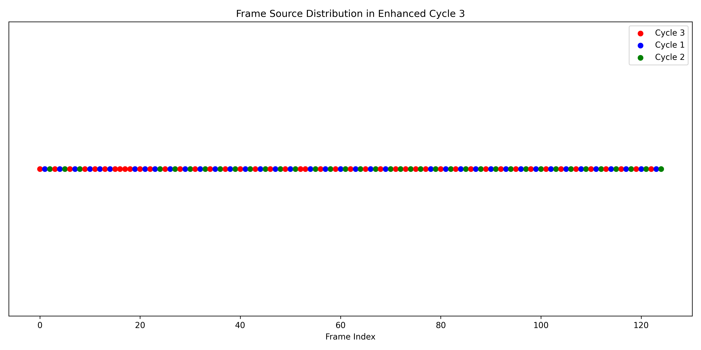

## Video Interpolation via ValveDTW

*Visualization of frame sources during ValveDTW interpolation process. This image shows how frames from different cardiac cycles are mapped and interpolated to enhance the temporal resolution.*

### 🎬 Demo Videos

#### 1. Original Video
[🎥 Watch Video](https://drive.google.com/file/d/1STasmR8C_WdvBUsJVxdun5fYJlW3lpbV/view?usp=drive_link)  

#### 2. Segmentation Mask
[🎥 Watch Video](https://drive.google.com/file/d/1c9gp0JsVk9k6nzWEbQPCIAYQOKp3ikhW/view?usp=drive_link) 

#### 3. The Third Cycle of the Original Cardiac Cycle
[🎥 Watch Video](https://drive.google.com/file/d/1EOeH9y9GzvkV602ULjK5ghwzerPh-P7Z/view?usp=drive_link)  

#### 4. The Third Cycle after Video Interpolation
[🎥 Watch Video](https://drive.google.com/file/d/1Zg4Ed4LKDFLLLrlSMbSmsVwt0CP_GWzK/view?usp=drive_link)  

## Code Release
🔄 **Status**: Uploaded

